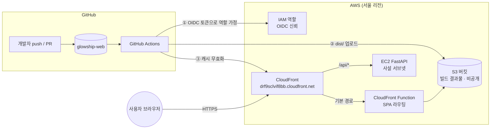
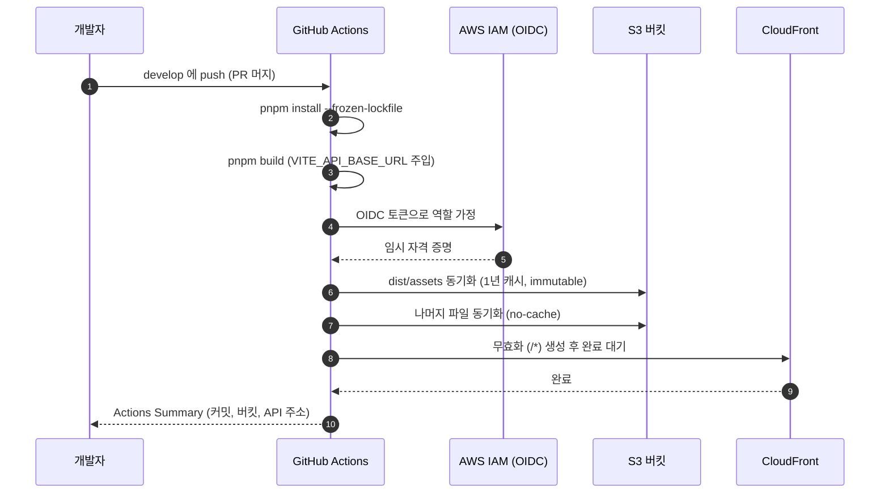
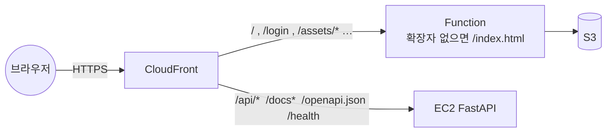

# dev 배포: S3 + CloudFront

> 티켓 GLOW-143 (2026-11-09). 백엔드 쪽 CI/CD와 AWS 전체 구성은 glowship-server 저장소의 `docs/backend/ci-cd.md`에 있습니다.
>
> 이 문서에는 계정 ID, 역할 ARN, 버킷 이름 같은 식별자와 비밀값을 적지 않습니다. 실제 값은 AWS 콘솔과 GitHub 저장소 Settings에서 확인합니다.

**관련 파일**

| 파일 | 역할 |
| --- | --- |
| `.github/workflows/deploy-dev.yml` | develop push 때 빌드 → S3 업로드 → CloudFront 캐시 무효화 |
| `.github/workflows/code-style.yml` | PR·push 때 ESLint, Prettier, 타입 검사, 빌드 (기존) |

---

## 1. 한눈에 보기

- 프론트는 Vite로 빌드한 **정적 파일**이라 서버가 필요 없습니다. S3에 올려 두고 CloudFront가 전달합니다.
- **API와 같은 주소**(`https://drf9sclvif8bb.cloudfront.net`)를 씁니다. `/api/*`만 CloudFront가 백엔드 EC2로 보냅니다. 같은 출처라 서버의 쿠키 로그인(SameSite=Lax)이 그대로 동작하고 CORS 문제도 없습니다.
- 도메인을 사지 않아도 CloudFront 기본 도메인으로 HTTPS가 됩니다.

---

## 2. 쓰는 서비스와 역할

| 서비스 | 무엇인가 | 여기서 하는 일 |
| --- | --- | --- |
| **GitHub Actions** | 저장소 이벤트에 반응해 가상 머신에서 작업을 실행하는 자동화 도구 | 빌드, S3 업로드, 캐시 무효화 |
| **GitHub OIDC 토큰** | Actions 실행마다 발급되는 짧은 신분증. 어느 저장소·브랜치에서 왔는지 적혀 있음 | AWS가 이걸 믿고 역할을 빌려줌. Access Key를 저장하지 않음 |
| **IAM 역할 `glowship-web-github-deploy`** | AWS 권한 묶음 | 이 저장소의 develop·dev 환경에서만 가정 가능. 권한은 프론트 버킷 읽기·쓰기·삭제와 CloudFront 무효화뿐 |
| **S3 (Simple Storage Service)** | 파일 저장소 | `dist/` 전체. 퍼블릭 접근 전부 차단, CloudFront만 읽기(OAC) |
| **CloudFront** | 전 세계 엣지에서 요청을 받아 뒤쪽으로 전달하는 CDN | 사용자 진입점. 기본 경로 → S3, `/api/*` 등 → EC2 |
| **CloudFront Function** | 엣지에서 요청을 가볍게 고치는 작은 JS 함수 | `/login`처럼 확장자 없는 경로를 `/index.html`로 바꿈. `vercel.json`의 rewrite와 같은 역할 |
| **OAC (Origin Access Control)** | CloudFront가 S3에 서명된 요청을 보내게 하는 설정 | 버킷을 공개하지 않고도 CloudFront가 읽을 수 있게 함 |

---

## 3. 배포 흐름 (`deploy-dev.yml`)

| 단계 | 내용 | 이유 |
| --- | --- | --- |
| 빌드 | `VITE_API_BASE_URL`을 Variables에서 넣어 `pnpm build` | Vite는 `VITE_*` 값을 빌드 시점에 번들에 넣음(`src/shared/config/env.ts`). `VITE_DEMO_LOGIN`은 넣지 않음(실서버 연동) |
| assets 업로드 | `dist/assets` → `Cache-Control: public, max-age=31536000, immutable` | 파일명에 해시가 붙어 내용이 바뀌면 이름도 바뀜. 오래 캐시해도 안전 |
| 나머지 업로드 | `index.html`, `favicon.svg` 등 → `Cache-Control: no-cache` | 이름이 고정이라 캐시하면 새 배포가 안 보임 |
| `--delete` | 로컬 `dist/`에 없는 파일은 버킷에서 삭제 | 옛 빌드 파일이 쌓이지 않게 |
| 무효화 | `/*` 전체 | 단순함 우선. 배포가 잦아지면 `index.html`만으로 줄일 수 있음 |

- develop push와 수동 실행(Run workflow)에서 돕니다. 배포끼리 겹치지 않게 직렬로 실행합니다.
- Environment `dev`를 써서 배포 이력이 남고, 필요하면 Settings → Environments에서 승인자를 둘 수 있습니다.

---

## 4. 사용자 요청 경로

| 요청 | 결과 |
| --- | --- |
| `/` | S3의 `index.html` |
| `/login`, `/delay-center/123` | Function이 `/index.html`로 바꿔 S3에서 가져옴 → React Router가 화면 결정 |
| `/assets/index-abc123.js` | S3의 그 파일 (1년 캐시) |
| `/api/v1/me` | 백엔드 EC2. 쿠키·헤더 그대로 전달, 캐시 없음 |
| 없는 정적 파일 | 403 (S3 비공개 버킷의 응답) |

- `fetcher`의 `baseURL`은 `VITE_API_BASE_URL + /api`입니다(`docs/api-client.md`). dev 배포에서는 `VITE_API_BASE_URL`이 CloudFront 주소라 결국 같은 출처의 `/api/...`를 부릅니다.
- `env.ts`가 빈 값을 거부하므로 상대 경로 대신 전체 주소를 넣습니다.

---

## 5. 한 번만 하는 준비

### 5.1 GitHub 저장소 Settings

| 종류 | 이름 | 내용 |
| --- | --- | --- |
| Secret | `AWS_ROLE_ARN` | 프론트 배포용 IAM 역할 ARN |
| Variable | `AWS_REGION` | 버킷 리전 |
| Variable | `WEB_BUCKET` | 빌드 결과물 버킷 이름 |
| Variable | `CLOUDFRONT_DISTRIBUTION_ID` | 무효화할 배포 ID |
| Variable | `VITE_API_BASE_URL` | `https://drf9sclvif8bb.cloudfront.net` (프론트와 같은 도메인) |
| Environment | `dev` | 배포 job이 사용 |

### 5.2 AWS 자원 (백엔드 문서 8절과 공유)

| 자원 | 내용 |
| --- | --- |
| IAM 역할 `glowship-web-github-deploy` | 신뢰: 이 저장소의 `develop`(ref)과 `environment:dev` OIDC 토큰. 권한: 버킷 `ListBucket`, 객체 `Put/Get/Delete`, 해당 배포 `CreateInvalidation` |
| S3 버킷 | 비공개. 퍼블릭 접근 차단. 버킷 정책으로 CloudFront 배포 하나만 `GetObject` |
| CloudFront 배포 | 기본 동작 → S3(캐시 켬, GET/HEAD). `/api/*`·`/docs*`·`/openapi.json`·`/health` → EC2(캐시 끔). HTTP → HTTPS 리다이렉트. 기본 루트 `index.html` |
| CloudFront Function `glowship-dev-web-spa-router` | viewer-request. 확장자 없는 경로를 `/index.html`로 |
| OAC | S3 오리진용 |

- 이 저장소의 GitHub OIDC 주체(sub)는 ID 포함 불변 형식(`repo:<조직>@<id>/<저장소>@<id>:...`)입니다. 신뢰 정책을 다시 쓸 때는 `gh api repos/<조직>/<저장소>/actions/oidc/customization/sub`로 확인합니다.

---

## 6. 운영 절차

| 상황 | 하는 일 |
| --- | --- |
| **배포** | PR을 develop에 머지하면 자동. 수동은 Actions → Deploy Dev → Run workflow |
| **확인** | Actions Summary에 커밋·버킷·API 주소. 브라우저에서 `https://drf9sclvif8bb.cloudfront.net/`과 `/login` 새로고침 |
| **새 배포가 안 보임** | 무효화 단계가 끝났는지 확인. 브라우저 강력 새로고침. `index.html`이 `no-cache`인지 확인 |
| **권한 오류** | `AccessDenied`는 IAM 역할 정책(버킷 이름·배포 ID가 맞는지), OIDC 거절은 신뢰 정책의 sub |
| **API 호출 실패** | 백엔드 배포 상태(`/health`)와 서버 설정의 `CORS_ORIGINS`에 이 도메인이 있는지 |
| **롤백** | 이전 커밋으로 develop을 되돌려 push하거나, 해당 커밋에서 Run workflow |

---

## 7. 참고

- `vercel.json`은 기획자 확인용 데모 배포(Vercel) 설정으로, 이 AWS 배포와 충돌하지 않습니다.
- 운영 배포는 dev와 같은 모양에 별도 버킷·배포와 Environment 승인자를 더하면 됩니다.
